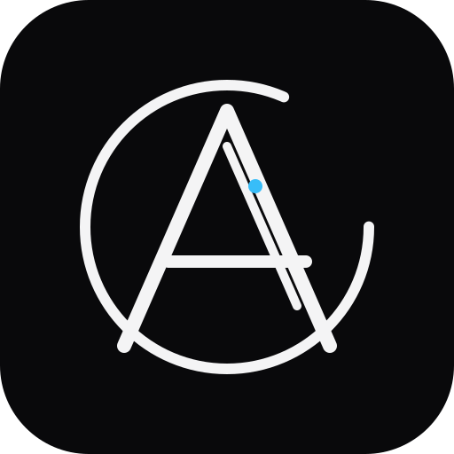
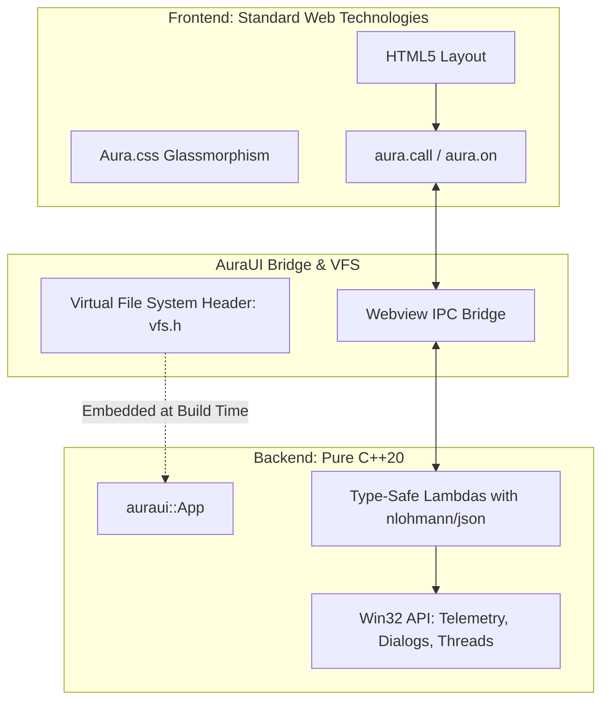

<div align="center">
  
  <h1>AuraUI</h1>
  <p><strong>The Modern, Lightweight C++ Desktop Framework with Standard HTML/CSS Styling</strong></p>

  <a href="https://github.com/Byukusenge-Andrew/auraui/actions/workflows/ci.yml"></a>
  <a href="https://byukusenge-andrew.github.io/auraui/"></a>
  <a href="LICENSE"></a>

  <p>
    📖 <a href="docs/USER_GUIDE.md"><strong>Full User Guide & Developer Manual</strong></a> | 🛡️ <a href="SECURITY_AUDIT.md"><strong>Security Audit Report</strong></a>
  </p>
</div>

AuraUI bridges the gap between **high-performance C++20 business logic** and the **speed and aesthetic power of modern HTML5/CSS3**. Build desktop apps with custom frameless title bars, sleek dark-mode aesthetics, and responsive layouts, all compiling to a **single standalone Windows executable (~450 KB)** with zero external dependencies.

---


## ⚡ Quick Start

```powershell
# 1. Create a new project
auraui new my-calculator

# 2. Navigate to project
cd my-calculator

# 3. Live Development with instant Hot-Reload on HTML/CSS save
auraui dev

# 4. Compile into a single standalone .exe with embedded assets
auraui build
```

The compiled release executable will be located in `dist/my-calculator.exe`.

---

## 🏗️ Architecture



---

## 🚀 C++ Developer Experience (Express with AuraUI Flair)

AuraUI brings the intuitive elegance of **Express.js** to high-performance C++20 with modern type safety, zero heap overhead, and microsecond latency.

### 1. Modern Express-Style API (`src/main.cpp`)

```cpp
#include "auraui.hpp"

#if __has_include("vfs.h")
#include "vfs.h"
#define HAS_EMBEDDED_VFS 1
#endif

int main() {
    // 1. Initialize native desktop window
    auraui::App app("Fast Calculator", 1000, 680);
    app.set_min_size(800, 500);

    // 2. Global Middleware: High-res ANSI route logger
    app.use(auraui::middleware::logger());

    // 3. Express-style Route Handlers with Req & Res
    app.route("calculate", [](auraui::Req& req, auraui::Res& res) {
        double a = req.get<double>("a", 0.0);
        double b = req.get<double>("b", 0.0);
        std::string op = req.get<std::string>("operation", "+");

        if (op == "/" && b == 0.0) {
            return res.error("Division by zero", 400);
        }

        double result = (op == "*") ? (a * b) : (a + b);
        res.ok({ {"result", result}, {"operation", op} });
    });

    // 4. Modular Sub-Routers (e.g. /api/users, /api/auth)
    auraui::Router api;
    api.route("ping", [](auraui::Req& req, auraui::Res& res) {
        res.ok({ {"message", "pong"}, {"latency_us", req.elapsed_us()} });
    });
    app.use("api", api);

    // 5. Embedded VFS for Single-File Distribution
#if !defined(AURA_DEV_MODE) && defined(HAS_EMBEDDED_VFS)
    app.set_vfs(aura_vfs_handler);
#endif

    // 6. Fluent Express-Style Listen
    app.listen("index.html");
    return 0;
}
```

### 2. Express Capabilities with C++20 Flare

| Feature | AuraUI C++ Syntax | Notes |
| :--- | :--- | :--- |
| **Request Object** | `req.get<T>("field")`, `req["field"]`, `req.elapsed_us()` | Type-safe JSON extraction with defaults |
| **Response Builder** | `res.ok({ ... })`, `res.error(msg, 400)`, `res.json(data)` | Fluent chainable response model |
| **Sub-Routers** | `auraui::Router router; app.use("prefix", router);` | Modular routing with nested subrouters |
| **Middleware Chain** | `app.use(auraui::middleware::logger())`, `app.use(fn)` | Microsecond pipeline with `next()` execution |
| **Application Lifecycle**| `app.listen("index.html")` | Boots hot-reload in dev, loads UI, runs event loop |
| **Route Alias Flexibility**| `aura.call('/api/ping')` or `aura.call('api.ping')` | Automatic slash, dot, and underscore normalization |

---

## 🎨 Frontend Styling & JavaScript Bridge

### Calling C++ from JavaScript (`ui/app.js`)

```javascript
// Seamless Promise-based call to C++
const response = await aura.call('calculate', {
    a: 42,
    b: 10,
    operation: '*'
});

console.log(response.result); // 420
```

### Listening to C++ Push Events (`ui/app.js`)

```javascript
aura.on('progress', (data) => {
    progressBar.style.width = `${data.percent}%`;
});
```

### Native OS Dialogs and System Telemetry

```javascript
// Native Win32 Open File Dialog
const file = await aura.dialog.open({ filter: 'Images (*.png;*.jpg)\0*.png;*.jpg\0' });

// Native Win32 Open Folder Dialog
const folder = await aura.dialog.openFolder({ title: 'Select Project Directory' });

// Native Win32 Save File Dialog
const savePath = await aura.dialog.save({ default_name: 'report.pdf' });

// Native Windows Clipboard (Read / Write)
await aura.clipboard.write('Result: 420');
const copied = await aura.clipboard.read();

// Open links in default browser or open folder in Windows Explorer
await aura.shell.open('https://github.com');
await aura.shell.open('C:\\Users');

// Windows RAM and CPU Telemetry
const sys = await aura.system.getInfo();
console.log(sys.memory.percent_used, sys.overview.cpu_cores);
```

### Declarative HTML Attributes
You can also trigger native actions without writing JavaScript:
- `<button data-aura-copy="#my-text">Copy</button>`: Copies the text of `#my-text` to clipboard.
- `<a data-aura-open="https://example.com">Website</a>`: Opens the link in the user's default browser.
- `<button data-aura-route="/settings">Settings</button>`: Seamlessly switches SPA route views.

---

## 🧭 Client-Side Routing & View Engine

AuraUI includes a built-in Single Page Application (SPA) routing system with smooth view transitions:

### 1. HTML Declarative Routing
```html
<!-- Nav Links -->
<nav class="aura-navbar">
    <button data-aura-route="/dashboard" class="aura-nav-link active">Dashboard</button>
    <button data-aura-route="/settings" class="aura-nav-link">Settings</button>
</nav>

<!-- Routed Views -->
<div class="aura-view-container">
    <div data-aura-view="/dashboard" class="aura-view active">
        <h1>Dashboard</h1>
    </div>
    <div data-aura-view="/settings" class="aura-view">
        <h1>Settings</h1>
    </div>
</div>
```

### 2. Programmatic Navigation & Route Hooks (`ui/app.js`)
```javascript
// Navigate programmatically
aura.router.navigate('/settings');

// Route lifecycle listener
aura.router.on('/settings', (params) => {
    console.log('Entered settings view');
});

// Switch view from C++ backend!
// C++: app.navigate("/settings");
```

---

## 💾 Persistent State Storage (`aura.store`)

Store configuration and user preferences across application launches:

```javascript
// Save preferences
aura.store.set('theme', 'dark');
aura.store.set('user_profile', { name: 'Alice', autoStart: true });

// Read preferences
const theme = aura.store.get('theme', 'dark');
const profile = aura.store.get('user_profile', {});
```

---

## 🎨 Pre-Built UI Design System (`aura.css`)

AuraUI comes with ready-to-use glassmorphic dark-mode CSS tokens:
- **Frameless Window Title Bar**: Drag region with native minimize, maximize, and close buttons.
- **Glassmorphic Cards**: `var(--bg-card)` with subtle 1px border dividers.
- **Color Accents**: Neon violet (`#6366f1`) and cyan (`#06b6d4`) gradients.
- **Form Controls**: Modern styled inputs, selects, switches, and sliders.
- **Badges & Indicators**: Pulsing status indicators and pill tags.

---

## 📁 Repository Structure

- [`auraui.cmd`](file:///d:/tradegraph/auraui.cmd): Batch wrapper for the AuraUI CLI tool.
- [`auraui/include/auraui.hpp`](file:///d:/tradegraph/auraui/include/auraui.hpp): Core C++ header framework.
- [`auraui/cli/auraui.py`](file:///d:/tradegraph/auraui/cli/auraui.py): Python CLI compiler and asset bundler.
- [`auraui/cli/aura.css`](file:///d:/tradegraph/auraui/cli/aura.css): Default design system.
- [`auraui/cli/aura.js`](file:///d:/tradegraph/auraui/cli/aura.js): JavaScript client bridge.
- [`docs/USER_GUIDE.md`](file:///d:/tradegraph/docs/USER_GUIDE.md): In-depth User Guide & API reference manual.
- [`showcase/`](file:///d:/tradegraph/showcase/): Complete demonstration application (multi-threaded prime benchmark, telemetry, native dialogs).
- [`templates/default/`](file:///d:/tradegraph/templates/default/): Starter boilerplate used by `auraui new`.
- [`SECURITY_AUDIT.md`](file:///d:/tradegraph/SECURITY_AUDIT.md): Formal Security Audit & Hardening Report detailing remediation for SEC-01 through SEC-07.
- [`LICENSE`](file:///d:/tradegraph/LICENSE): MIT License.


