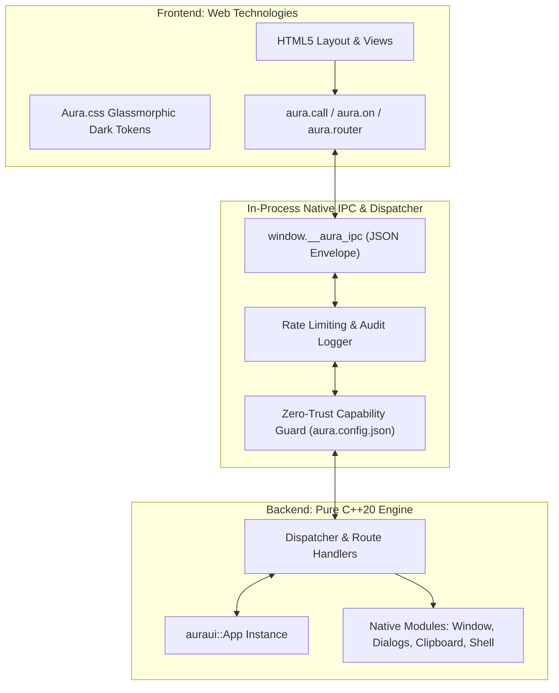

# 📖 AuraUI 2 User Guide & Developer Manual

> **The Secure, Cross-Platform C++20 Desktop Application Framework with Web UI and Single-Binary Compilation.**

---

## 📑 Table of Contents

1. [Introduction & Architectural Overview](#1-introduction--architectural-overview)
2. [Platform Matrix & Prerequisites](#2-platform-matrix--prerequisites)
3. [Project Configuration: `aura.config.json`](#3-project-configuration-auraconfigjson)
4. [Build System & Presets (CMake & CLI)](#4-build-system--presets-cmake--cli)
5. [C++ Backend Guide (`auraui.hpp`)](#5-c-backend-guide-aurauihpp)
   - [Application Lifecycle & Options](#application-lifecycle--options)
   - [Route Registration (`app.bind` / `app.route`)](#route-registration-appbind--approute)
   - [Request Context & Arguments (`auraui::Context`)](#request-context--arguments-aurauicontext)
   - [Middleware & Rate Limiting](#middleware--rate-limiting)
   - [Pushing Events to Frontend (`app.emit`)](#pushing-events-to-frontend-appemit)
   - [Result & Error Handling](#result--error-handling)
   - [Native Modules: Dialogs, Clipboard, Shell, System](#native-modules-dialogs-clipboard-shell-system)
6. [Frontend JavaScript Guide (`aura.js`)](#6-frontend-javascript-guide-aurajs)
   - [In-Process IPC Bridge (`aura.call`)](#in-process-ipc-bridge-auracall)
   - [Subscribing to Backend Events (`aura.on`)](#subscribing-to-backend-events-auraon)
   - [Client-Side Single-Page Router (`aura.router`)](#client-side-single-page-router-aurarouter)
   - [Persistent Local Storage (`aura.store`)](#persistent-local-storage-aurastore)
   - [Frameless Window Controls (`aura.window`)](#frameless-window-controls-aurawindow)
   - [Native Dialogs, Clipboard & Shell via JS](#native-dialogs-clipboard--shell-via-js)
7. [UI Design System & Styling (`aura.css`)](#7-ui-design-system--styling-auracss)
   - [Frameless Titlebars & Drag Regions](#frameless-titlebars--drag-regions)
   - [Glassmorphic Dark Theme Tokens](#glassmorphic-dark-theme-tokens)
   - [Components: Cards, Inputs, Badges, Buttons](#components-cards-inputs-badges-buttons)
8. [Multi-Threading & Worker Tasks](#8-multi-threading--worker-tasks)
9. [Zero-Trust Security Model](#9-zero-trust-security-model)
10. [Architecture Decision Records (ADRs)](#10-architecture-decision-records-adrs)
11. [Troubleshooting & FAQ](#11-troubleshooting--faq)

---

## 1. Introduction & Architectural Overview

AuraUI bridges high-performance **C++20** with standard web technologies (**HTML5, modern CSS3, ES6+ JavaScript**). Unlike Electron which bundles a ~150 MB Chromium runtime, AuraUI renders frontends inside the host OS's native webview engine:

- **Windows**: Microsoft Edge WebView2 (in-process native control).
- **macOS**: `WKWebView` (Cocoa / AppKit native control).
- **Linux**: WebKitGTK (`libwebkit2gtk-4.1` native control).



### Key Highlights
- **Zero Exposed Ports**: All IPC flows directly in-process through native webview bindings (`window.__aura_ipc`). No local HTTP or WebSocket server is created.
- **Zero-Trust Capabilities**: Deny-by-default security model enforced before any command reaches user code.
- **Ultra-Compact Footprint**: Standalone binaries range from **~750 KB to 1.5 MB** with zero runtime DLL dependencies.
- **Single C++ Header & Modern CMake**: Pure standard C++20 with `CMakePresets.json` as the unified build configuration.

---

## 2. Platform Matrix & Prerequisites

| Operating System | Backend Window Technology | Prerequisites & Compiler | Binary Size |
| :--- | :--- | :--- | :--- |
| **Windows 10 / 11** | Edge WebView2 (in-process) | Visual Studio 2022 (MSVC v143, C++20). Evergreen WebView2 runtime is pre-installed. Static CRT (`/MT`) eliminates runtime redistributables. | ~750 KB – 1.2 MB |
| **macOS 12+** (Intel & Apple Silicon) | `WKWebView` (Cocoa) | Xcode 14+ / Apple Clang with C++20 support. | ~800 KB – 1.5 MB |
| **Linux** (X11 & Wayland) | WebKitGTK | GCC 12+ or Clang 15+ with `libwebkit2gtk-4.1-dev`. | ~900 KB – 1.8 MB |

### Common Tools
- **CMake**: Version 3.24 or newer.
- **Python**: Version 3.10+ (for the CLI developer toolchain).

---

## 3. Project Configuration: `aura.config.json`

Every AuraUI 2 application declares its window metadata and security permissions in an `aura.config.json` manifest located at the project root:

```json
{
  "$schema": "https://raw.githubusercontent.com/Byukusenge-Andrew/auraui/main/aura.config.schema.json",
  "app": {
    "name": "my-desktop-app",
    "version": "1.0.0",
    "title": "My Desktop Application",
    "author": "Acme Corp"
  },
  "window": {
    "width": 1180,
    "height": 780,
    "min_width": 900,
    "min_height": 600,
    "resizable": true,
    "frameless": true,
    "center": true
  },
  "security": {
    "capabilities": [
      "window.minimize",
      "window.maximize",
      "window.close",
      "dialog.open",
      "dialog.save",
      "clipboard.read",
      "clipboard.write",
      "shell.open",
      "system.info"
    ],
    "rate_limit_per_sec": 100,
    "max_payload_bytes": 1048576
  }
}
```

### Capabilities Reference

| Capability | Permitted API Commands |
| :--- | :--- |
| `window.*` | `window.minimize`, `window.maximize`, `window.close`, `window.title` |
| `dialog.*` | `dialog.open`, `dialog.save`, `dialog.folder` |
| `clipboard.read` | `clipboard.read` (reading OS clipboard contents) |
| `clipboard.write` | `clipboard.write` (writing text to OS clipboard) |
| `shell.open` | `shell.open` (opening whitelisted web URLs in the default browser) |
| `system.info` | `system.info` (querying system RAM, CPU, OS platform) |

---

## 4. Build System & Presets (CMake & CLI)

AuraUI uses **CMake 3.24+ with `CMakePresets.json`** as its single source of truth for builds, testing, and CI pipelines ([ADR-006](file:///d:/tradegraph/docs/adr/0006-build-system.md)).

### 1. Building via CMake Presets

```bash
# Configure Windows Release build
cmake --preset win-msvc-release

# Compile executable
cmake --build --preset win-msvc-release

# Run unit and integration tests
ctest --preset unit-tests
```

Available Presets:
- `win-msvc-debug` / `win-msvc-release`
- `linux-gcc-debug` / `linux-gcc-release`
- `macos-arm64-release` / `macos-universal-release`

### 2. AuraUI CLI & Adding to PATH

To run the `auraui` command from any terminal or directory:

- **Windows 1-Click Installer**: Run `install.bat` in the repository root. It permanently appends `bin/` to your Windows User `PATH`.
- **Pip Install**: Run `pip install -e .` from the repository root.
- **Manual**: Add the `bin/` directory to your system or user `PATH`.

Once in `PATH`, you can use the commands directly:

```bash
# Show CLI help
auraui --help

# Create a new project template
auraui new my-app

# Run live development mode
auraui dev

# Compile standalone production release
auraui build
```

---

## 5. C++ Backend Guide (`auraui.hpp`)

Include the single master header `#include "auraui.hpp"` to access all core types, routers, and native capabilities under the `auraui` namespace.

### Application Lifecycle & Options

```cpp
#include "auraui.hpp"

int main() {
    // 1. Configure application options
    auraui::AppOptions opts;
    opts.title = "AuraUI Showcase";
    opts.width = 1180;
    opts.height = 780;
    opts.asset_path = "ui";        // Auto-detects "ui" or "dist" if empty
    opts.manifest_path = "aura.config.json";

    // 2. Instantiate application
    auraui::App app(opts);

    // 3. Register global middleware
    app.use(auraui::middleware::logger());

    // 4. Register custom route bindings
    app.bind("calculate_sum", [](const auraui::Context& ctx) {
        int a = ctx.get<int>("a", 0);
        int b = ctx.get<int>("b", 0);
        return auraui::json{{"sum", a + b}};
    });

    // 5. Start event loop
    return app.run("index.html");
}
```

---

### Route Registration (`app.bind` / `app.route`)

AuraUI supports both functional command bindings and Express-style routing:

```cpp
// 1. Direct command binding returning JSON
app.bind("users.get", [](const auraui::Context& ctx) {
    std::string id = ctx.get<std::string>("id", "");
    return auraui::json{
        {"id", id},
        {"name", "Jane Doe"},
        {"role", "Administrator"}
    };
});

// 2. Express-style REST route
app.route("api/health", [](const auraui::Context& ctx) {
    return auraui::json{
        {"status", "healthy"},
        {"timestamp", std::time(nullptr)}
    };
});
```

---

### Request Context & Arguments (`auraui::Context`)

The `Context` object encapsulates incoming request payloads and metadata:

```cpp
app.bind("orders.create", [](const auraui::Context& ctx) {
    // Access request ID and command name
    std::string req_id = ctx.id();
    std::string cmd = ctx.cmd();

    // Type-safe property access with fallback
    std::string customer = ctx.get<std::string>("customer", "Anonymous");
    double total = ctx.get<double>("total", 0.0);
    bool priority = ctx.get<bool>("priority", false);

    // Check key presence
    if (ctx.has("items")) {
        const auto& items = ctx["items"];
        // Process items array...
    }

    return auraui::json{{"success", true}, {"order_id", "ORD-9482"}};
});
```

---

### Middleware & Rate Limiting

Middleware functions execute before route handlers and can inspect, modify, or reject requests:

```cpp
// Custom authentication or validation middleware
app.use([](auraui::Context& ctx, auraui::Next next) {
    if (ctx.cmd().starts_with("admin.") && !ctx.has("auth_token")) {
        return auraui::make_error(auraui::ErrorCode::permission_denied, "Admin token required");
    }
    return next(ctx);
});
```

---

### Pushing Events to Frontend (`app.emit`)

The C++ backend can push real-time events to the frontend from any thread:

```cpp
// Broadcast event with JSON payload to all active webviews
app.emit("telemetry_tick", {
    {"cpu_percent", 3.8},
    {"ram_used_mb", 214.5},
    {"timestamp", std::time(nullptr)}
});
```

---

### Result & Error Handling

Core APIs return `Result<T>` implemented with `tl::expected<T, Error>` ([ADR-005](file:///d:/tradegraph/docs/adr/0005-error-handling.md)). Handlers can return errors that are cleanly formatted into JSON error envelopes:

```cpp
app.bind("data.fetch", [](const auraui::Context& ctx) -> auraui::Result<auraui::json> {
    std::string key = ctx.get<std::string>("key", "");
    if (key.empty()) {
        return auraui::make_error(auraui::ErrorCode::invalid_argument, "Key cannot be empty");
    }
    return auraui::json{{"data", "Value for " + key}};
});
```

---

### Native Modules: Dialogs, Clipboard, Shell, System

All native modules operate through secure platform wrappers and enforce UTF-8 conversions ([ADR-007](file:///d:/tradegraph/docs/adr/0007-text-encoding.md)):

```cpp
// 1. File Picker Dialogs
std::string file = auraui::dialog::open("Select File", "JSON Files (*.json)\0*.json\0");
std::string save = auraui::dialog::save("Save Report", "report.csv");
std::string dir  = auraui::dialog::folder("Select Output Directory");

// 2. Unicode Clipboard (UTF-8 to Win32 Wide APIs)
auraui::clipboard::write("Copied text from C++");
std::string copied = auraui::clipboard::read();

// 3. Protocol-Whitelisted Shell Open
auraui::shell::open("https://github.com/Byukusenge-Andrew/auraui");

// 4. System Telemetry
auto sys = auraui::system::info();
std::cout << "RAM: " << sys.ram_used_mb << " / " << sys.ram_total_mb << " MB\n";
```

---

## 6. Frontend JavaScript Guide (`aura.js`)

The `aura.js` client provides an in-process native IPC bridge, an SPA router, and a persistent state store.

### In-Process IPC Bridge (`aura.call`)

```javascript
// Call bound C++ functions
try {
    const res = await aura.call('calculate_sum', { a: 15, b: 27 });
    console.log('Sum result:', res.sum); // 42
} catch (err) {
    console.error('IPC error code:', err.code, 'message:', err.message);
}
```

---

### Subscribing to Backend Events (`aura.on`)

```javascript
// Subscribe to real-time events emitted by app.emit()
const unsubscribe = aura.on('telemetry_tick', (data) => {
    document.getElementById('cpu-val').innerText = `${data.cpu_percent}%`;
    document.getElementById('ram-val').innerText = `${data.ram_used_mb} MB`;
});

// To stop listening:
// unsubscribe();
```

---

### Client-Side Single-Page Router (`aura.router`)

AuraUI includes a zero-dependency SPA router using declarative markup:

```html
<!-- Navigation bar -->
<nav class="nav-links">
    <button data-aura-route="/dashboard" class="active">Dashboard</button>
    <button data-aura-route="/transactions">Transactions</button>
    <button data-aura-route="/settings">Settings</button>
</nav>

<!-- View containers -->
<div data-aura-view="/dashboard" class="aura-view active">
    <h1>Dashboard</h1>
</div>
<div data-aura-view="/transactions" class="aura-view">
    <h1>Transactions</h1>
</div>
<div data-aura-view="/settings" class="aura-view">
    <h1>Settings</h1>
</div>
```

```javascript
// Programmatic navigation
aura.router.navigate('/transactions');

// Route lifecycle hook
aura.router.on('/transactions', () => {
    loadTransactionHistory();
});
```

---

### Persistent Local Storage (`aura.store`)

Store local configuration across restarts:

```javascript
// Set values
aura.store.set('theme', 'dark');
aura.store.set('profile', { name: 'Owner', autoSave: true });

// Read values with fallbacks
const theme = aura.store.get('theme', 'dark');
const profile = aura.store.get('profile', {});

// Remove key
aura.store.remove('theme');
```

---

### Frameless Window Controls (`aura.window`)

```javascript
document.getElementById('btn-min').onclick = () => aura.window.minimize();
document.getElementById('btn-max').onclick = () => aura.window.maximize();
document.getElementById('btn-close').onclick = () => aura.window.close();
```

---

### Native Dialogs, Clipboard & Shell via JS

```javascript
// Open file picker
const file = await aura.dialog.open({
    title: 'Select Database File',
    filter: 'SQLite Database (*.db)\0*.db\0'
});

// Clipboard
await aura.clipboard.write('Hello World!');
const text = await aura.clipboard.read();

// Open URL in default system browser
await aura.shell.open('https://github.com');
```

---

## 7. UI Design System & Styling (`aura.css`)

AuraUI bundles a pre-built glassmorphic design system in `aura.css`.

### Frameless Titlebars & Drag Regions

```html
<header class="aura-topbar">
    <div class="aura-brand" style="-webkit-app-region: drag;">
        <span class="brand-title">AuraUI Application</span>
    </div>
    <div class="aura-window-controls">
        <button class="win-btn" onclick="aura.window.minimize()">🗕</button>
        <button class="win-btn" onclick="aura.window.maximize()">🗖</button>
        <button class="win-btn win-close" onclick="aura.window.close()">✕</button>
    </div>
</header>
```

---

### Glassmorphic Dark Theme Tokens

```css
:root {
    --aura-bg-primary: #07090e;
    --aura-bg-surface: #0f141f;
    --aura-bg-card: rgba(22, 27, 34, 0.7);
    --aura-border: rgba(255, 255, 255, 0.08);
    --aura-accent: #38bdf8;
    --aura-accent-hover: #0284c7;
    --aura-text: #f8fafc;
    --aura-text-muted: #94a3b8;
}
```

---

## 8. Multi-Threading & Worker Tasks

Keep the UI responsive at 60 FPS by executing compute-heavy logic on background worker threads:

```cpp
#include <thread>

app.bind("compute.heavy", [&app](const auraui::Context& ctx) {
    int iterations = ctx.get<int>("iterations", 100000);

    std::thread([&app, iterations]() {
        double result = 0.0;
        for (int i = 0; i < iterations; ++i) {
            result += std::sqrt(i);
        }

        // Push completed notification
        app.emit("compute.complete", {
            {"status", "success"},
            {"result", result}
        });
    }).detach();

    return auraui::json{{"status", "queued"}};
});
```

---

## 9. Zero-Trust Security Model

AuraUI incorporates defense-in-depth principles across all layers:

1. **Deny-by-Default Capabilities**: Capabilities must be explicitly declared in `aura.config.json` ([ADR-003](file:///d:/tradegraph/docs/adr/0003-capabilities.md)).
2. **In-Process IPC Gateway**: Requests pass through a single choke point with strict 1 MiB payload limits and rate limiting ([ADR-002](file:///d:/tradegraph/docs/adr/0002-ipc-envelope.md)).
3. **Powerbox Pattern**: File dialogs return cryptographically random grant tokens rather than raw system paths.
4. **Shell Protocol Whitelist**: `shell.open` rejects executable extensions (`.exe`, `.bat`, `.cmd`, `.ps1`) and only permits `http://`, `https://`, and `mailto:`.
5. **Universal UTF-8 Encoding**: Prevents Win32 ANSI buffer overflows and surrogate-pair crashes ([ADR-007](file:///d:/tradegraph/docs/adr/0007-text-encoding.md)).

---

## 10. Architecture Decision Records (ADRs)

Refer to the complete specifications in the `docs/adr/` directory:

- **[ADR-001: Window Backend Architecture](file:///d:/tradegraph/docs/adr/0001-window-backend.md)**
- **[ADR-002: Unified IPC Envelope and Dispatcher](file:///d:/tradegraph/docs/adr/0002-ipc-envelope.md)**
- **[ADR-003: Zero-Trust Capabilities System](file:///d:/tradegraph/docs/adr/0003-capabilities.md)**
- **[ADR-004: Asset Serving and Origin Isolation](file:///d:/tradegraph/docs/adr/0004-asset-origin.md)**
- **[ADR-005: Error Handling Across Boundaries](file:///d:/tradegraph/docs/adr/0005-error-handling.md)**
- **[ADR-006: Build System and Presets](file:///d:/tradegraph/docs/adr/0006-build-system.md)**
- **[ADR-007: Universal UTF-8 Internal Encoding](file:///d:/tradegraph/docs/adr/0007-text-encoding.md)**

---

## 11. Troubleshooting & FAQ

### Q: Why does my build fail with `Cannot open include file: 'auraui.hpp'`?
**A**: Ensure your `target_include_directories` contains the path to `${AURA_ROOT}/include` and `${AURA_ROOT}/include/auraui`.

### Q: Why does calling `dialog.open` return a permission error?
**A**: Add `"dialog.open"` to the `"security.capabilities"` array inside your `aura.config.json`.

### Q: Can I use modern web frameworks like React, Vue, or Svelte?
**A**: Yes! Configure Vite or your bundler to output into the `ui/` directory. AuraUI will serve or bundle the compiled assets directly.
