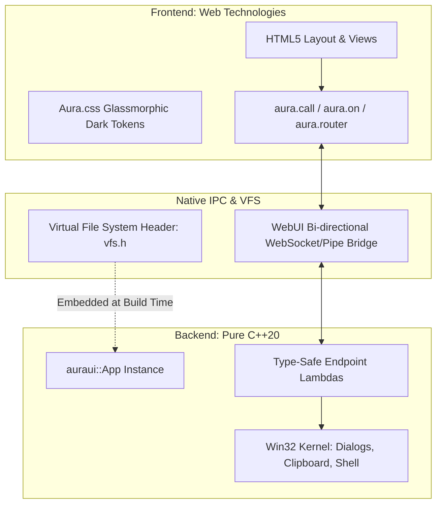

# 📖 AuraUI User Guide & Developer Manual

> **A modern, lightweight C++20 desktop framework powered by native HTML5/CSS3 frontends and single-binary compilation.**

---

## 📑 Table of Contents

1. [Introduction & Architectural Overview](#1-introduction--architectural-overview)
2. [Prerequisites & Environment Setup](#2-prerequisites--environment-setup)
3. [CLI Reference (`auraui`)](#3-cli-reference-auraui)
   - [Scaffolding a Project: `auraui new`](#scaffolding-a-project-auraui-new)
   - [Live Development: `auraui dev`](#live-development-auraui-dev)
   - [Production Packaging: `auraui build`](#production-packaging-auraui-build)
4. [Project Directory Anatomy](#4-project-directory-anatomy)
5. [C++ Backend Guide (`auraui.hpp`)](#5-c-backend-guide-aurauihpp)
   - [Application Lifecycle & Window Configuration](#application-lifecycle--window-configuration)
   - [Express-Style Route Handlers (`app.bind` / `app.get` / `app.post`)](#express-style-route-handlers)
   - [Reading Request Parameters & Payloads (`Context`)](#reading-request-parameters--payloads-context)
   - [Sending Responses (`ctx.json`, `ctx.text`, `ctx.error`)](#sending-responses)
   - [Pushing Events to Frontend (`app.emit`)](#pushing-events-to-frontend-appemit)
   - [Server-Side Route Switching (`app.navigate`)](#server-side-route-switching-appnavigate)
   - [Native Dialogs, Clipboard & Shell](#native-dialogs-clipboard--shell)
6. [Frontend JavaScript Guide (`aura.js`)](#6-frontend-javascript-guide-aurajs)
   - [Calling C++ Functions (`aura.call`)](#calling-c-functions-auracall)
   - [Subscribing to Backend Events (`aura.on` / `aura.off`)](#subscribing-to-backend-events-auraon--auraoff)
   - [Client-Side Single-Page Router (`aura.router`)](#client-side-single-page-router-aurarouter)
   - [Persistent Local Storage (`aura.store`)](#persistent-local-storage-aurastore)
   - [Native Window Controls (`aura.window`)](#native-window-controls-aurawindow)
   - [Native OS Dialogs, Clipboard & Shell via JS](#native-os-dialogs-clipboard--shell-via-js)
7. [UI Design System & Styling (`aura.css`)](#7-ui-design-system--styling-auracss)
   - [Frameless Titlebar & Window Controls](#frameless-titlebar--window-controls)
   - [Glassmorphic Theme Tokens](#glassmorphic-theme-tokens)
   - [Cards, Inputs, Buttons & Indicators](#cards-inputs-buttons--indicators)
8. [Multi-Threading & High-Performance Compute](#8-multi-threading--high-performance-compute)
9. [Security Best Practices](#9-security-best-practices)
10. [Troubleshooting & FAQ](#10-troubleshooting--faq)

---

## 1. Introduction & Architectural Overview

AuraUI bridges high-performance **C++20** with standard web technologies (**HTML5, modern CSS3, ES6 JavaScript**). Unlike Electron which bundles a ~150 MB Chromium runtime, AuraUI leverages the host OS's native webview engine (Microsoft Edge WebView2 on Windows) alongside an embedded virtual file system (VFS).



### Key Highlights
- **Ultra-Compact Footprint**: Compiled release executables are typically **~480 KB** and completely self-contained.
- **Zero Runtime Dependencies**: No Node.js, Python, or external DLLs needed on the end-user's machine.
- **Hot-Reload Development**: Edit HTML, CSS, and JS files live without recompiling C++.
- **Single C++ Header & Static Lib**: Clean include path without bloated third-party build systems.

---

## 2. Prerequisites & Environment Setup

To develop with AuraUI on Windows, ensure the following tools are installed:

| Requirement | Supported Version | Notes |
| :--- | :--- | :--- |
| **Operating System** | Windows 10 / 11 (x64) | Ships with Evergreen WebView2 Runtime pre-installed |
| **C++ Compiler** | MSVC (Visual Studio 2022 or Build Tools) | Requires "Desktop development with C++" with C++20 support |
| **Python** | Python 3.10+ | Used by the CLI (`auraui.cmd`) for asset bundling |
| **Git** | 2.30+ | Version control |

### Verifying MSVC Setup
Ensure the Visual Studio installer includes **MSVC v143 - VS 2022 C++ x64/x86 build tools** and **Windows 10/11 SDK**. The AuraUI CLI automatically detects and invokes `vcvarsall.bat` during compilation.

---

## 3. CLI Reference (`auraui`)

AuraUI comes with a unified command-line tool accessible through `auraui.cmd` at the repository root:

```powershell
# Display help and available commands
auraui --help
```

### Scaffolding a Project: `auraui new`
Creates a new project directory with ready-to-run boilerplate:

```powershell
auraui new <project-name>
```

Example:
```powershell
auraui new my-desktop-app
cd my-desktop-app
```

Generated structure:
- `src/main.cpp`: C++ entry point with window initialization and route bindings.
- `ui/index.html`: Main markup with frameless titlebar and view routing containers.
- `ui/app.js`: Frontend logic and backend event listeners.
- `ui/style.css`: Project-specific styling.
- `ui/aura.css`: AuraUI glassmorphism design system.
- `ui/aura.js`: AuraUI frontend bridge library.

---

### Live Development: `auraui dev`
Starts the app in development mode:

```powershell
auraui dev
```

- Compiles an unoptimized development binary `build_dev/app_dev.exe`.
- Binds directly to the local `ui/` directory on disk.
- Changes to HTML, CSS, and JavaScript take effect immediately upon refreshing or saving.

---

### Production Packaging: `auraui build`
Compiles a standalone, optimized single-binary executable:

```powershell
auraui build
```

1. **Asset Bundling**: Scans `ui/` and converts all HTML, CSS, JS, SVG, and font assets into hex byte arrays in `src/vfs.h`.
2. **MSVC Release Compilation**: Compiles `src/*.cpp` with `/std:c++20 /O2 /MD /EHsc` and statically links `webui-2-static.lib`.
3. **Output Binary**: Emits the standalone executable in `dist/<project-name>.exe` (sub-500 KB).

---

## 4. Project Directory Anatomy

A typical AuraUI project is laid out as follows:

```
my-desktop-app/
├── auraui.json            # Project metadata (name, window title, dimensions)
├── dist/                  # Production builds (created by auraui build)
│   └── my-desktop-app.exe # Standalone release executable
├── src/
│   ├── main.cpp           # C++ business logic and route bindings
│   └── vfs.h              # Auto-generated virtual file system (build time)
└── ui/
    ├── index.html         # Application layout and view containers
    ├── style.css          # Custom application styles
    ├── app.js             # Application JavaScript logic
    ├── aura.css           # Framework glassmorphic styling
    └── aura.js            # Framework bridge client
```

---

## 5. C++ Backend Guide (`auraui.hpp`)

All C++ facilities reside in the `auraui` namespace within [auraui.hpp](file:///d:/tradegraph/auraui/include/auraui.hpp).

### Application Lifecycle & Window Configuration

```cpp
#include "auraui.hpp"

#if __has_include("vfs.h")
#include "vfs.h"
#define HAS_EMBEDDED_VFS 1
#endif

int main() {
    // Initialize window with title, width, and height
    auraui::App app("My Desktop App", 1024, 700);

    // Set minimum window bounds
    app.set_min_size(800, 500);

    // Center window on primary monitor
    app.set_center();

    // Enable/disable clipboard inspection by the frontend
    app.allow_clipboard_read(true);

    // Start event loop (blocks until window is closed)
    return app.run();
}
```

---

### Express-Style Route Handlers

AuraUI uses an intuitive callback syntax inspired by Express.js:

```cpp
// General binding
app.bind("calculate_sum", [](const auraui::Context& ctx) {
    int a = ctx.get<int>("a", 0);
    int b = ctx.get<int>("b", 0);
    ctx.json({{"sum", a + b}});
});

// REST-style aliases
app.get("/api/user", [](const auraui::Context& ctx) {
    ctx.json({{"name", "Alice"}, {"role", "Admin"}});
});

app.post("/api/settings", [](const auraui::Context& ctx) {
    std::string theme = ctx.get<std::string>("theme", "dark");
    // Persist settings...
    ctx.json({{"success", true}});
});
```

---

### Reading Request Parameters & Payloads (`Context`)

The `auraui::Context` object wraps incoming request details:

```cpp
app.bind("process_data", [](const auraui::Context& ctx) {
    // 1. Extract typed field with fallback value
    int count = ctx.get<int>("count", 10);
    std::string query = ctx.get<std::string>("query", "");

    // 2. Access raw nlohmann::json payload
    const nlohmann::json& body = ctx.body();
    if (body.contains("items") && body["items"].is_array()) {
        for (const auto& item : body["items"]) {
            // ...
        }
    }
});
```

---

### Sending Responses

Use `ctx.json()`, `ctx.text()`, or `ctx.error()` to respond to the frontend:

```cpp
// JSON response (accepts nlohmann::json)
ctx.json({
    {"status", "ok"},
    {"items", {"apple", "banana", "cherry"}}
});

// Plain text response
ctx.text("Operation completed successfully");

// Error response (formats {"error": "..."})
ctx.error("Item not found");
```

---

### Pushing Events to Frontend (`app.emit`)

The C++ backend can push real-time events to the frontend at any time (e.g., from background worker threads):

```cpp
// Broadcast event with JSON payload
app.emit("telemetry_update", {
    {"cpu_percent", 4.2},
    {"ram_used_mb", 182.5}
});
```

---

### Server-Side Route Switching (`app.navigate`)

Switch the active view in the frontend UI directly from C++:

```cpp
// Changes the active view to data-aura-view="/dashboard"
app.navigate("/dashboard");
```

---

### Native Dialogs, Clipboard & Shell

AuraUI provides cross-thread safe Win32 OS wrappers:

```cpp
// 1. Open File Dialog
std::string selected_file = auraui::open_file_dialog("Select Image", "Image Files (*.png;*.jpg)\0*.png;*.jpg\0");

// 2. Save File Dialog
std::string save_path = auraui::save_file_dialog("Save Report", "report.csv", "CSV Files (*.csv)\0*.csv\0");

// 3. Choose Folder Dialog
std::string folder = auraui::choose_folder_dialog("Choose Output Directory");

// 4. Clipboard Interop (Full UTF-8 / UTF-16 Unicode)
auraui::set_clipboard_text("Hello from C++!");
std::string clip_content = auraui::get_clipboard_text();

// 5. Open Web URL or Document in Explorer (Hardened & Sanitized)
auraui::open_external("https://github.com");

// 6. System Telemetry
auraui::SystemInfo info = auraui::get_system_info();
std::cout << "RAM: " << info.ram_used_mb << " / " << info.ram_total_mb << " MB\n";
```

---

## 6. Frontend JavaScript Guide (`aura.js`)

The `aura.js` client is injected automatically into all views. It exposes the global `aura` object.

### Calling C++ Functions (`aura.call`)

`aura.call(name, payload)` invokes a backend C++ function and returns a standard JavaScript `Promise`:

```javascript
// ui/app.js
async function runSum() {
    try {
        const response = await aura.call('calculate_sum', { a: 15, b: 27 });
        console.log('Result:', response.sum); // 42
    } catch (err) {
        console.error('Calculation failed:', err);
    }
}
```

---

### Subscribing to Backend Events (`aura.on` / `aura.off`)

Listen for events dispatched by `app.emit()` from C++:

```javascript
// Register event listener
const unsubscribe = aura.on('telemetry_update', (data) => {
    document.getElementById('cpu-label').innerText = `${data.cpu_percent}%`;
    document.getElementById('ram-label').innerText = `${data.ram_used_mb} MB`;
});

// To remove listener:
// unsubscribe();
```

---

### Client-Side Single-Page Router (`aura.router`)

AuraUI includes a zero-dependency client router with declarative markup:

#### 1. HTML View Containers (`ui/index.html`)
Use `data-aura-view` to define pages and `data-aura-route` for navigation links:

```html
<!-- Navigation bar -->
<nav>
    <button data-aura-route="/home" class="active">Home</button>
    <button data-aura-route="/analytics">Analytics</button>
    <button data-aura-route="/settings">Settings</button>
</nav>

<!-- Views -->
<div data-aura-view="/home" class="aura-view active">
    <h1>Welcome Home</h1>
</div>

<div data-aura-view="/analytics" class="aura-view">
    <h1>System Analytics</h1>
</div>

<div data-aura-view="/settings" class="aura-view">
    <h1>Application Settings</h1>
</div>
```

#### 2. Programmatic Navigation & Route Hooks (`ui/app.js`)
```javascript
// Navigate programmatically
aura.router.navigate('/analytics');

// Listen to route entry
aura.router.on('/analytics', () => {
    console.log('User entered analytics view');
    loadCharts();
});

// Route Navigation Guards (middleware)
aura.router.beforeEach((to, from, next) => {
    if (to === '/settings' && !isUserAdmin()) {
        alert('Access denied');
        next(false); // Cancel transition
    } else {
        next(true); // Proceed
    }
});
```

---

### Persistent Local Storage (`aura.store`)

Save and retrieve client state across app restarts:

```javascript
// Write state
aura.store.set('app_theme', 'dark');
aura.store.set('user_config', { volume: 80, autoLaunch: true });

// Read state with fallback
const theme = aura.store.get('app_theme', 'light');
const config = aura.store.get('user_config', { volume: 50 });

// Remove state
aura.store.remove('app_theme');
```

---

### Native Window Controls (`aura.window`)

Control the frameless host window:

```javascript
document.getElementById('btn-minimize').addEventListener('click', () => {
    aura.window.minimize();
});

document.getElementById('btn-maximize').addEventListener('click', () => {
    aura.window.maximize();
});

document.getElementById('btn-close').addEventListener('click', () => {
    aura.window.close();
});
```

---

### Native OS Dialogs, Clipboard & Shell via JS

```javascript
// Open file picker
const file = await aura.dialog.open({
    title: 'Select Configuration File',
    filter: 'JSON Files (*.json)\0*.json\0'
});

// Save file picker
const savePath = await aura.dialog.save({
    title: 'Save Report',
    defaultName: 'export.csv'
});

// Clipboard
await aura.clipboard.write('Copied from AuraUI webview');
const clipText = await aura.clipboard.read();

// Open URL in system default browser (Chrome/Edge/Firefox)
await aura.shell.open('https://github.com');
```

---

## 7. UI Design System & Styling (`aura.css`)

AuraUI provides a pre-built glassmorphic dark theme in `aura.css`.

### Frameless Titlebar & Window Controls

To create a native-looking frameless window with custom buttons:

```html
<header class="aura-titlebar">
    <div class="aura-titlebar-drag">
        <span class="aura-titlebar-icon">⚡</span>
        <span class="aura-titlebar-text">AuraUI Application</span>
    </div>
    <div class="aura-window-controls">
        <button class="aura-win-btn win-min" onclick="aura.window.minimize()">🗕</button>
        <button class="aura-win-btn win-max" onclick="aura.window.maximize()">🗖</button>
        <button class="aura-win-btn win-close" onclick="aura.window.close()">✕</button>
    </div>
</header>
```

> [!NOTE]
> Add the CSS property `-webkit-app-region: drag;` to `.aura-titlebar-drag` to enable dragging the window natively across monitors.

---

### Glassmorphic Theme Tokens

Override these CSS variables in your `ui/style.css` to customize the palette:

```css
:root {
    --bg-primary: #0a0c10;
    --bg-secondary: #12161f;
    --bg-card: rgba(22, 27, 34, 0.65);
    --border-glass: rgba(255, 255, 255, 0.08);
    --accent-primary: #6366f1;   /* Indigo */
    --accent-secondary: #06b6d4; /* Cyan */
    --text-primary: #f8fafc;
    --text-secondary: #94a3b8;
}
```

---

### Cards, Inputs, Buttons & Indicators

```html
<!-- Glassmorphic Card -->
<div class="aura-card">
    <div class="aura-card-header">
        <h3>System Metrics</h3>
        <span class="aura-badge badge-success">Online</span>
    </div>
    <div class="aura-card-body">
        <input type="text" class="aura-input" placeholder="Search parameters...">
        <button class="aura-btn btn-primary">Execute</button>
    </div>
</div>
```

---

## 8. Multi-Threading & High-Performance Compute

Heavy computational workloads should be dispatched asynchronously to worker threads to keep the UI running at a fluid 60 FPS:

```cpp
#include <thread>
#include <future>

app.bind("compute_heavy_task", [&app](const auraui::Context& ctx) {
    int iterations = ctx.get<int>("iterations", 1000000);

    // Spawn non-blocking background thread
    std::thread([&app, iterations]() {
        double result = 0.0;
        for (int i = 0; i < iterations; ++i) {
            result += std::sin(i) * std::cos(i);
        }

        // Push result to frontend once completed
        app.emit("heavy_task_complete", {
            {"status", "success"},
            {"result", result}
        });
    }).detach();

    // Acknowledge immediate start
    ctx.json({{"status", "started"}});
});
```

---

## 9. Security Best Practices

Refer to the formal [SECURITY_AUDIT.md](file:///d:/tradegraph/SECURITY_AUDIT.md) for vulnerability test cases and remediation details.

1. **Content-Security-Policy (CSP)**:
   Always declare a strict CSP in `ui/index.html`:
   ```html
   <meta http-equiv="Content-Security-Policy" content="default-src 'self'; style-src 'self' 'unsafe-inline'; script-src 'self' 'unsafe-inline';">
   ```
2. **Restrict Clipboard Access**:
   If your application does not need to read the operating system clipboard, disable it explicitly in C++:
   ```cpp
   app.allow_clipboard_read(false);
   ```
3. **Safe Shell Execution**:
   Always use `auraui::open_external(url)` or `aura.shell.open(url)`. AuraUI enforces protocol allowlists (`http://`, `https://`, `mailto:`), blocks hazardous file extensions, and prevents UNC network share injection.

---

## 10. Troubleshooting & FAQ

### Q: `cl.exe` is not recognized or MSVC build tools not found.
**A**: Ensure Visual Studio 2022 or "Visual Studio C++ Build Tools" is installed with the **Desktop development with C++** workload. AuraUI automatically locates `vcvarsall.bat` at standard paths.

### Q: Why does `auraui dev` show old UI changes?
**A**: Ensure `build_dev/` does not contain a stale `vfs.h`. In dev mode, AuraUI automatically loads live assets from `ui/`. Simply press `Ctrl + R` or `F5` in the window to reload.

### Q: Can I use React, Vue, or Svelte with AuraUI?
**A**: Yes! Configure your framework's build output (`vite build` or `npm run build`) to emit into the `ui/` directory. Then run `auraui dev` or `auraui build`.

### Q: How do I change the executable icon?
**A**: Place a Windows resource script `icon.rc` alongside `src/main.cpp` containing:
```rc
1 ICON "icon.ico"
```
The MSVC linker will automatically embed the icon into the compiled `.exe`.
